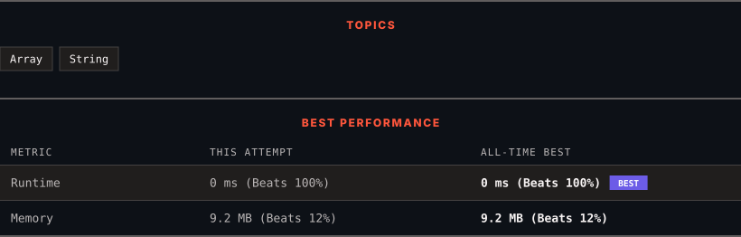

<div align="center">

# 1816. Truncate Sentence

      

[](https://leetcode.com/problems/truncate-sentence/)

</div>

---

<div align="center">

<picture>
  <source media="(prefers-color-scheme: dark)" srcset="panel-dark.svg">
  <source media="(prefers-color-scheme: light)" srcset="panel-light.svg">
  
</picture>

</div>

> **New personal best** — Runtime improved on this submission.

### HOW IT WENT

| | |
|:--|:--|
| **Attempts** | first try |
| **Time to solve** | 1 h 20 min |
| **Verdicts** | ✅ Accepted |

---

### NOTES

_No notes yet._

---

### SOLUTIONS (1)

| # | File | Language | Date |
|:-:|------|:--------:|:----:|
| 1 | [sol1.cpp](./sol1.cpp) | `C++` | 2026-10-12 ← **latest** |

---

### PROBLEM DESCRIPTION

A **sentence** is a list of words that are separated by a single space with no leading or trailing spaces. Each of the words consists of **only** uppercase and lowercase English letters (no punctuation).

	- For example, `"Hello World"`, `"HELLO"`, and `"hello world hello world"` are all sentences.

You are given a sentence `s`​​​​​​ and an integer `k`​​​​​​. You want to **truncate** `s`​​​​​​ such that it contains only the **first** `k`​​​​​​ words. Return `s`​​​​*​​ after **truncating** it.*

 

**Example 1:**

```

**Input:** s = "Hello how are you Contestant", k = 4
**Output:** "Hello how are you"
**Explanation:**
The words in s are ["Hello", "how", "are", "you", "Contestant"].
The first 4 words are ["Hello", "how", "are", "you"].
Hence, you should return "Hello how are you".

```

**Example 2:**

```

**Input:** s = "What is the solution to this problem", k = 4
**Output:** "What is the solution"
**Explanation:**
The words in s are ["What", "is", "the", "solution", "to", "this", "problem"].
The first 4 words are ["What", "is", "the", "solution"].
Hence, you should return "What is the solution".
```

**Example 3:**

```

**Input:** s = "chopper is not a tanuki", k = 5
**Output:** "chopper is not a tanuki"

```

 

**Constraints:**

	- `1 <= s.length <= 500`

	- `k` is in the range `[1, the number of words in s]`.

	- `s` consist of only lowercase and uppercase English letters and spaces.

	- The words in `s` are separated by a single space.

	- There are no leading or trailing spaces.

---

<div align="center">

<sub>Auto-synced by <strong>LeetSync</strong> · Built by <a href="https://deveshsamant.in/">Devesh Samant</a></sub>

</div>
